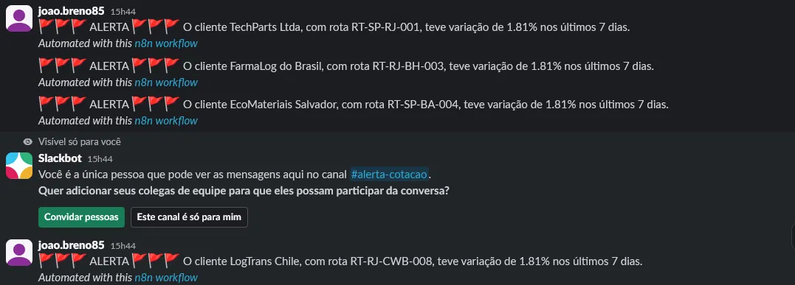
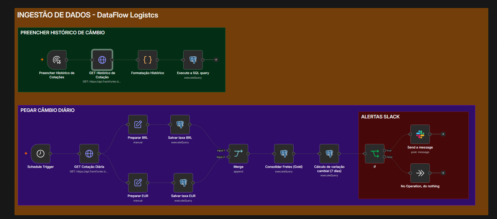
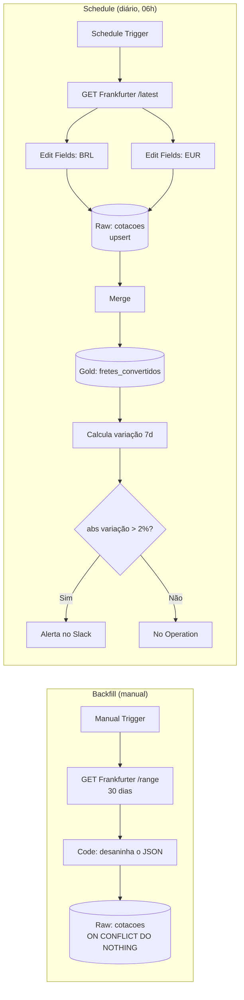

# DataFlow Logistics — Pipeline de Ingestão de Cotações com n8n

Pipeline de ingestão de dados construído em **n8n**, que coleta cotações de câmbio de uma API pública, armazena em um **PostgreSQL (Supabase)**, converte os fretes para a moeda local de cada cliente e **alerta no Slack** quando o câmbio varia mais de 2% em 7 dias.

### Alerta no Slack:



### Fluxo N8N:



---

## 📌 Contexto de negócio

**DataFlow Logistics** é uma empresa fictícia de logística que opera no Brasil e na Europa, movimentando cargas para clientes que faturam em moedas diferentes (**BRL**, **EUR** e **USD**).

> **Ingestão de dados** é o processo de buscar dados nas mais variadas fontes e trazê-los para um banco de dados interno, onde possam ser consolidados e analisados.

### Problemas que o projeto resolve

| Problema                                                                                                          | Impacto                                                                                                                              | Solução                                                             |
| ----------------------------------------------------------------------------------------------------------------- | ------------------------------------------------------------------------------------------------------------------------------------ | ------------------------------------------------------------------- |
| **Fretes precificados em USD** — todas as rotas têm valor base em dólar, mas cada cliente paga na sua moeda local | É preciso converter os valores diariamente com a cotação atualizada                                                                  | Coleta automática da cotação USD→BRL e USD→EUR                      |
| **Variação cambial impacta a margem**                                                                             | Se o câmbio varia mais de **2% em 7 dias**, o frete na moeda local muda de forma significativa e os contratos precisam ser ajustados | Cálculo da variação em 7 dias + alerta automático no Slack          |
| **Dados de cadastro isolados** — clientes, rotas e fretes estão no PostgreSQL, sem cruzamento com o câmbio        | Não existe uma visão única do negócio                                                                                                | Tabela consolidada (Gold) com cadastro + cotação + valor convertido |

---

## 🏗️ Arquitetura

O workflow possui **duas pernas**, que alimentam a camada **Raw** e a camada **Gold**:

1. **Backfill (manual):** carga histórica dos últimos 30 dias, executada uma única vez.
2. **Schedule (automático):** cotação do dia, executada diariamente.



---

## 📥 Fontes de dados

| Fonte                                          | O que fornece                                                                                                       | Uso                                                    |
| ---------------------------------------------- | ------------------------------------------------------------------------------------------------------------------- | ------------------------------------------------------ |
| **[Frankfurter API](https://frankfurter.dev)** | Cotações USD→BRL e USD→EUR                                                                                          | `/range` para o histórico e `/latest` para o dia atual |
| **PostgreSQL (Supabase)**                      | Tabelas de cadastro: `clientes` (nome, moeda principal, segmento) e `rotas` (código, origem, destino, frete em USD) | Cadastro cruzado com o câmbio na camada Gold           |

---

## ⚙️ Orquestração no n8n

### Backfill (execução manual)

1. **Manual Trigger** dispara a carga.
2. **HTTP Request** busca o range dos últimos 30 dias (`base=USD&symbols=BRL,EUR`).
3. **Code** desaninha a resposta da API (datas → moedas → taxas) em uma linha por data e moeda.
4. **Postgres** grava na camada Raw com `ON CONFLICT ... DO NOTHING` (não sobrescreve o que já existe).

### Schedule (diário às 06h)

1. **HTTP Request** busca a cotação mais recente (`/latest`).
2. **Edit Fields** (um nó para BRL e outro para EUR) padroniza os campos no formato da tabela Raw.
3. **Postgres** grava a taxa na Raw com upsert (`ON CONFLICT ... DO UPDATE`).
4. **Merge** aguarda as duas gravações terminarem.
5. **Postgres** consolida a camada Gold (`fretes_convertidos`).
6. **Postgres** calcula a variação cambial em 7 dias.
7. **IF** avalia se `|variação| > 2%`: se sim, envia o alerta no Slack; se não, não faz nada.

---

## 🗄️ Modelo de dados

### 🥉 Camada Raw — `cotacoes`

Cotações brutas, exatamente como vêm da API.

| Coluna          | Descrição                         |
| --------------- | --------------------------------- |
| `moeda_base`    | Moeda de origem (`USD`)           |
| `moeda_destino` | Moeda convertida (`BRL` ou `EUR`) |
| `taxa`          | Cotação do dia                    |
| `data_cotacao`  | Data da cotação                   |
| `capturado_em`  | Timestamp da última captura       |

**Idempotência:** chave única em `(moeda_base, moeda_destino, data_cotacao)` com `ON CONFLICT`, então reexecutar o pipeline nunca duplica dados.

### 🥇 Camada Gold — `fretes_convertidos`

Visão consolidada: **rota + cliente + frete na moeda local**, calculada com a cotação mais recente (via subquery).

| Coluna              | Descrição                            |
| ------------------- | ------------------------------------ |
| `rota_codigo`       | Código da rota (ex.: `RT-SP-RJ-001`) |
| `cliente_nome`      | Nome do cliente                      |
| `moeda_cliente`     | Moeda em que o cliente paga          |
| `valor_frete_usd`   | Frete base em dólar                  |
| `taxa_aplicada`     | Cotação usada na conversão           |
| `valor_frete_local` | `valor_frete_usd × taxa_aplicada`    |
| `data_cotacao`      | Data da cotação utilizada            |
| `calculado_em`      | Timestamp do cálculo                 |

Chave única em `(rota_codigo, data_cotacao)`.

---

## 🚨 Regra de alerta

A variação compara a taxa atual com a taxa de 7 dias atrás:

```
variação % = (taxa_hoje − taxa_7d) / taxa_7d × 100
```

Se `|variação %| > 2`, uma mensagem é enviada ao canal `#alerta-cotacao` no Slack:

> 🚩🚩🚩 ALERTA 🚩🚩🚩 O cliente _TechParts Ltda_, com rota _RT-SP-RJ-001_, teve variação de _X%_ nos últimos 7 dias.

---

## 🧰 Stack

- **n8n** — orquestração do workflow
- **PostgreSQL (Supabase)** — armazenamento (Raw e Gold)
- **Frankfurter API** — cotações de câmbio
- **Slack** — alertas

---

## ▶️ Como executar

1. Importe o arquivo `Ingestão de dados - DataFlow Logistics.json` no n8n.
2. Configure as credenciais do **Postgres (Supabase)** e do **Slack**.
3. Crie as tabelas `clientes`, `rotas`, `cotacoes` e `fretes_convertidos`.
4. Execute o **Backfill** manualmente uma vez para carregar o histórico.
5. Ative o workflow para que o **Schedule** rode todos os dias.

---
